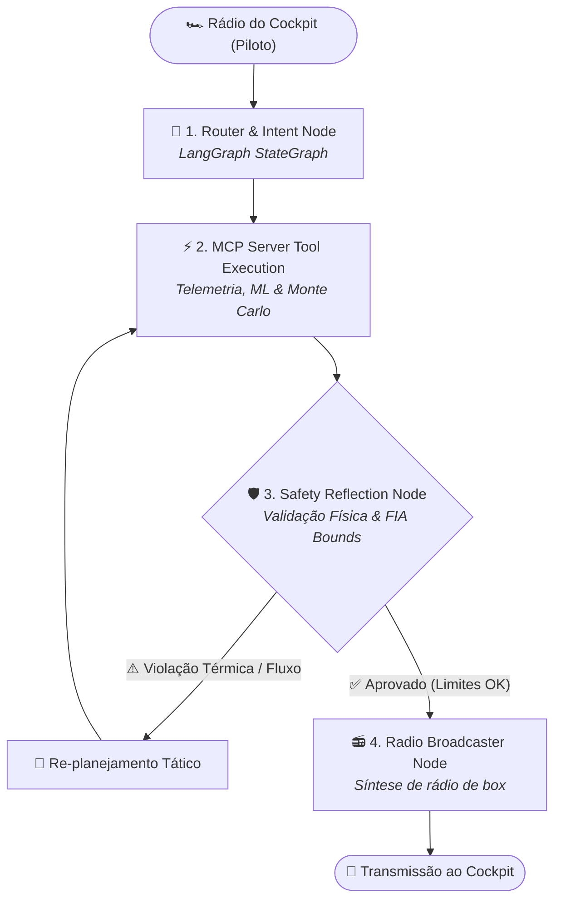

# 🏎️ F1 Global Pit-Wall Intelligence, ML & Strategy AI (`f1-pitwall-ai`)

[](https://f1-pitwall-ai.streamlit.app/)
[](https://geovana28.github.io/f1-pitwall-ai/)
[](https://github.com/langchain-ai/langgraph)
[-purple?style=for-the-badge)](https://modelcontextprotocol.io)
[-brightgreen?style=for-the-badge)](https://scikit-learn.org)
[](https://github.com/Geovana28/f1-pitwall-ai)
[](https://opensource.org/licenses/MIT)

> **🇧🇷 Idioma**: Português (Brasil) | **🇺🇸 [English Executive Summary](#-english-executive-summary)**
>
> **Plataforma Global de Engenharia de Corrida, Agente Autônomo com LangGraph StateGraph, Servidor Model Context Protocol (MCP v1.0), Modelo Preditivo de Machine Learning (Gradient Boosting 92.07%), Simulação Estocástica de Monte Carlo e Telemetria para todos os 24 Circuitos da Fórmula 1.**

---

### 🤖 Agente Autônomo com LangGraph & Servidor MCP (Model Context Protocol)

O projeto integra um **Agente Autônomo de Pista baseado em LangGraph StateGraph cíclico** e um servidor compatível com o protocolo **Model Context Protocol (MCP v1.0)** da Anthropic (JSON-RPC 2.0):



#### Capacidades do Agente:
* **LangGraph Cyclic StateGraph (`agent/graph.py`)**: Máquina de estados com nós de roteamento, execução de ferramentas MCP, autocrítica de segurança física e síntese de rádio.
* **Servidor MCP Oficial (`mcp_server/server.py`)**: Expõe ferramentas via protocolo JSON-RPC 2.0 (`get_live_telemetry`, `predict_podium_ml`, `simulate_pit_stop_strategy`, `validate_telemetry_physics`).
* **Inferência de Machine Learning em Tempo Real**: Conectado ao modelo de `GradientBoostingClassifier` treinado com 1.838 telemetrias reais da F1 (92.07% de acurácia e 0.949 ROC-AUC).
* **CLI Interativo de Rádio (`demo_cli.py`)**: Terminal interativo para simulação de rádio com trace em tempo real de cada nó do grafo.

---

### 🌐 English Executive Summary
**F1 Pit-Wall AI** is a global motorsport race engineering, vehicle dynamics, and strategy platform designed and built by **Geovana Luiza Morais Moreira**. It covers all 24 FIA World Championship circuits and all 10 F1 constructors. Core capabilities include: ISA atmospheric density reduction by track altitude, aero setup trade-offs (wing level, ride height, ERS deployment), Monte Carlo strategy simulations under stochastic Safety Car deployments, tire degradation curves with rain crossover physics (Slick / Intermediate / Wet), and a pit-wall Race Engineer Agent powered by tool calling and domain guardrails.

---

---

## 🌍 Arquitetura Completa Implementada (5 Módulos)

1. **Catálogo Mundial dos 24 Circuitos (`data/circuits_catalog.json`) + Detecção Automática do Próximo GP (`get_next_upcoming_gp`)**:
   - Cobertura integral das 24 etapas do campeonato mundial (Bahrain, Jeddah, Melbourne, Suzuka, Shanghai, Miami, Imola, Mônaco, Barcelona, Montreal, Spielberg, Silverstone, Spa-Francorchamps, Hungaroring, Zandvoort, Monza, Baku, Singapura, Austin, Cidade do México, **Interlagos / São Paulo**, Las Vegas, Qatar e Abu Dhabi).
   - Integração em tempo real com a API meteorológica **`Open-Meteo`** nas coordenadas GPS `(lat, lon)` de cada autódromo, altitude barométrica real ($h$), alocação oficial de compostos Pirelli (`C1` a `C5`), abrasividade do asfalto, *pit lane time loss* e probabilidade histórica de *Safety Car*.
2. **Catálogo das 10 Equipes & 20 Pilotos (`data/teams_catalog.json`) + Simulador Físico de Setup (`evaluate_car_setup_physics`)**:
   - Escolha qualquer uma das **10 equipes do grid** (**McLaren MCL39**, **Ferrari SF-25**, **Red Bull RB21**, **Mercedes W16**, **Aston Martin AMR25**, **Williams FW47**, **Racing Bulls VCARB 02**, **Haas VF-25**, **Alpine A525** e **Sauber/Audi C45**) e qualquer um dos 20 pilotos.
   - Ajuste o **Ângulo de Asa (*Downforce Level* 1–50)**, **Altura do Assoalho (*Ride Height* em mm)** e **Modo de Bateria (ERS Deployment)** para simular o *trade-off* entre Velocidade Máxima na Reta com DRS ($\text{km/h}$), velocidade de contorno de curva (*apex speed*) e degradação térmica dos pneus.
3. **Simulador Estocástico de Corrida por Monte Carlo & Crossover de Chuva (`src/monte_carlo_race.py`)**:
   - **`run_monte_carlo_strategy_comparison`**: Roda centenas de corridas estocásticas comparando `1-Stop (Medium → Hard)`, `1-Stop (Soft → Hard)` e `2-Stop (Soft → Medium → Medium)`, sorteando intervenções de *Safety Car* (que reduzem o *pit loss* em $\approx 42\%$ se coincidirem com a janela de parada) e variância log-normal de *pit stop*.
   - **`compute_wet_crossover_curve`**: Modela o tempo de volta em função da lâmina d'água na pista ($0{,}0\text{ mm}$ a $4{,}5\text{ mm}$) e determina os pontos exatos de *Crossover* para trocar do pneu *Slick* para o **Intermediate (Verde — $0{,}75\text{ mm}$)** e **Full Wet (Azul — $2{,}50\text{ mm}$)**.
4. **Comparador de Telemetria de Volta (`src/telemetry_loader.py`)**:
   - Gera e sobrepõe os canais de velocidade instantânea ($\text{km/h}$), pedal do acelerador ($0\text{–}100\%$), zonas de frenagem e ativação de DRS ao longo dos metros da pista entre duas equipes rivais.
5. **Agente Engenheiro de Corrida com Tool Calling & Guardrails (`src/race_engineer_agent.py`)**:
   - Roteador de ferramentas matemáticas (`compute_pit_window_and_undercut`, `simulate_safety_car_monte_carlo`, `evaluate_rain_crossover`, `compare_car_setup_and_telemetry` e `out_of_scope_guardrail`) que responde no rádio do Pit-Wall fundamentado nos números exatos da simulação.

---

## 📐 Fundamentação Matemática & Física

### 1. Densidade Barométrica Internacional (ISA) e Redução Aerodinâmica por Altitude

$$\rho(h, T) = \rho_0 \left( 1 - \frac{L \cdot h}{T_0} \right)^{\frac{g}{R \cdot L}} \cdot \frac{T_0}{T}$$

Como as forças de arrasto e *downforce* escalam linearmente com a densidade do fluido ($F = \frac{1}{2} \rho v^2 C_L A$), a plataforma recalcula automaticamente a perda aerodinâmica de cada autódromo — ex.: **Cidade do México** ($2.240\text{ m} \implies -23{,}8\%$ ar), **Interlagos** ($765\text{ m} \implies -8{,}5\%$ ar) e **Spa-Francorchamps** ($410\text{ m} \implies -4{,}8\%$ ar).

### 2. Física de Setup do Carro (Asa, Altura do Assoalho & ERS) e Ritmo de Volta

$$T(\ell, c, a) = T_{\text{base, pista}} + \Delta_{\text{equipe, setup}} + \Delta_c + \gamma_{\text{fuel}}(L_{\text{total}} - \ell) + \theta(T_{\text{track}}, \text{setup}) \cdot \left[ \alpha_c \cdot a + \beta_c \cdot \max(0, \, a - a_{\text{cliff}, c})^2 \right]$$

---

## 🚀 Como Executar

### 1. Plataforma Web Interativa (Zero Instalação)
Abra `index.html` diretamente no navegador ou acesse o [**Live Demo no GitHub Pages**](https://geovana28.github.io/f1-pitwall-ai/).

### 2. Executar a Suíte Automatizada de Testes (`pytest`)
```bash
pytest tests/ -v
```

---

## 📄 Licença
Distribuído sob a licença MIT (`LICENSE`). Desenvolvido por **Geovana Morais** — [Portfólio](https://geovana28.github.io).
